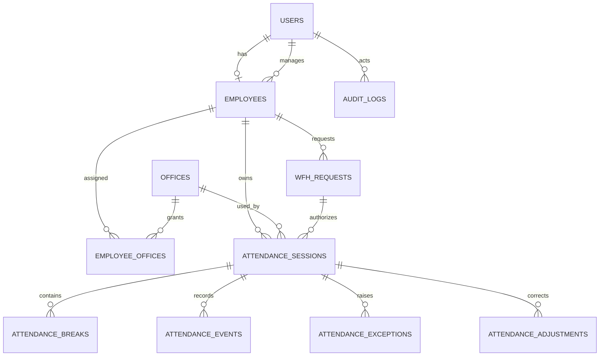

# Architecture Plan

## Decisions
- Modular monolith; no microservices.
- PostgreSQL is persistent source of truth.
- FastAPI owns business rules and authorization.
- SQLAlchemy models the domain; Alembic owns schema changes.
- Role authorization is centralized in `app/core/permissions.py`.
- Manager authorization must be resource-scoped using `Employee.primary_manager_id`.
- Attendance state transitions live in `attendance_service.py`.
- Location is collected only for office attendance events.
- WFH does not require home GPS.

## ERD

## State machine
`NOT_STARTED → WORKING → ON_BREAK → WORKING → ... → COMPLETED`.
Invalid transitions are rejected server-side.

## GPS flow
Select assigned active office → browser geolocation → backend checks employee active, office active, assignment, GPS accuracy, Haversine distance → punch accepted/rejected.

## WFH flow
Employee submits date range → PENDING → scoped manager or Super Admin reviews → APPROVED/REJECTED/CANCELLED → only an approved request covering today can authorize WFH attendance.

## Security model
Super Admin has all permissions. Manager permissions are limited to team attendance/WFH/exceptions/registrations. Employees can punch, request WFH and read only their own data.
